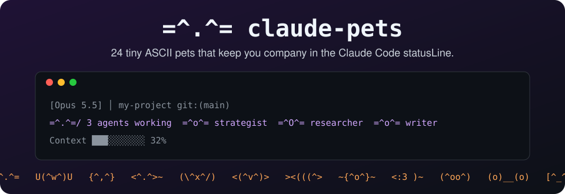
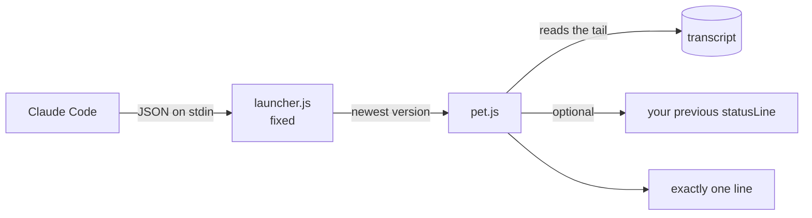

<div align="center">



# claude-pets

**A tiny ASCII kitty that keeps you company in the Claude Code statusLine.**<br>
She takes **exactly one line**. Always. By design. And when your agent team gets to work, every agent gets its own little pet with its real name.

  <a href="https://github.com/jfcarpiopuntocom/claude-pets/actions/workflows/test.yml"></a>
  
  
  
  
  <a href="LICENSE"></a>

[Install](#-install) · [Gallery](#-gallery) · [Pick a pet](#-pick-a-pet) · [FAQ](#-questions-nobody-asked) · [Español](https://github.com/jfcarpiopuntocom/claude-mascotas)

</div>

---

## 🐾 What is it?

An ASCII pet that lives in your [Claude Code](https://code.claude.com) statusLine and reacts to what is going on:

```
[Opus 5.5] │ my-project git:(main)
=^o^= on it...  @
Context ███░░░░░░░ 32%
```

| When… | The kitty |
|---|---|
| nothing is happening | `=^.^= purring` |
| Claude is working | `=^o^= on it...` |
| your agent team is at work | `=^.^=/ 2 agents working  =^o^= strategist  =^O^= researcher` |
| something broke | `=;.;= something broke, take a look` |
| you have been away a while | `=-.-= z napping... zzz` |

Frames alternate every second, so she **blinks, breathes and dozes off**.

## 🚀 Install

Inside Claude Code:

```
/plugin marketplace add jfcarpiopuntocom/claude-pets
/plugin install pets@claude-pets
/pets:setup
```

Restart Claude Code. Say hi to your kitty.

<details>
<summary><b>Can't type <code>/</code>?</b></summary>

From any terminal:

```
claude plugin marketplace add jfcarpiopuntocom/claude-pets
claude plugin install pets@claude-pets
```

Then open Claude Code and ask it: *"run the pets setup command"*.
</details>

### 🔄 Automatic updates

`/plugin` → **Marketplaces** → `claude-pets` → **Enable auto-update**. Done: every new pet reaches you on its own. Your statusLine points at a fixed launcher that always runs the newest installed version, so you never set it up twice.

### 🤝 Already have a statusLine?

`/pets:setup` keeps it (claude-hud, ccstatusline, your own…) and slips the pet in as **one** line right below the model line. It backs up your `settings.json` first.

## 🖼️ Gallery

24 to start with. This is just the beginning.

<!-- gallery:start -->
| Pet | Chilling | On it | Something broke | Napping | Key |
|---|---|---|---|---|---|
| Kitty | `=^.^=` | `=^o^=` | `=;.;=` | `=-.-= z` | `kitty` |
| Dog | `U'.'U` | `U'o'U` | `U;.;U` | `U-.-U z` | `dog` |
| Owl | `{o,o}` | `{O,O}` | `{@,@}` | `{-,-} z` | `owl` |
| Dragon | `<^.^>~` | `<^o^>~~` | `<x.x>~` | `<-.->~ z` | `dragon` |
| Bunny | `(='.'=)` | `(='o'=)` | `(=;.;=)` | `(=-.-=) z` | `bunny` |
| Penguin | `<('.')>` | `<('o')>` | `<(;.;)>` | `<(-.-)> z` | `penguin` |
| Fish | `><(('>` | `><((o>` | `><((x>` | `><((-> z` | `fish` |
| Octopus | `~(o.o)~` | `~(O.O)~` | `~(x.x)~` | `~(-.-)~ z` | `octopus` |
| Mouse | `<:3 )~` | `<:o )~` | `<:x )~` | `<:- )~ z` | `mouse` |
| Pig | `(^oo^)` | `(^OO^)` | `(xoox)` | `(-oo-) z` | `pig` |
| Frog | `(@..@)` | `(@oo@)` | `(x..x)` | `(-..-) z` | `frog` |
| Robot | `[o_o]` | `[O_O]` | `[x_x]` | `[-_-] z` | `robot` |
| Alien | `(@_@)` | `(@o@)` | `(x_x)` | `(-_-) z` | `alien` |
| Monkey | `@('_')@` | `@('o')@` | `@(x_x)@` | `@(-_-)@ z` | `monkey` |
| Bear | `c(^.^)c` | `c(^o^)c` | `c(x.x)c` | `c(-.-)c z` | `bear` |
| Bird | `(.>` | `(o>` | `(x>` | `(-> z` | `bird` |
| Duck | `__(.)<` | `__(o)<` | `__(x)<` | `__(-)< z` | `duck` |
| Crab | `(\/)(o,,o)(\/)` | `(\/)(O,,O)(\/)` | `(\/)(x,,x)(\/)` | `(\/)(-,,-)(\/) z` | `crab` |
| Bat | `/\(o.o)/\` | `/\(O.O)/\` | `/\(x.x)/\` | `\/(-.-)\/ z` | `bat` |
| Spider | `//(o.o)\\` | `//(O.O)\\` | `//(x.x)\\` | `//(-.-)\\ z` | `spider` |
| Caterpillar | `oooo(o.o)` | `oooo(O.O)` | `oooo(x.x)` | `oooo(-.-) z` | `caterpillar` |
| Snake | `~~~~:>` | `~~~~o>` | `~~~~x>` | `~~~~-> z` | `snake` |
| Ghost | `(o.o)~` | `(O.O)~` | `(x.x)~` | `(-.-)~ z` | `ghost` |
| Hedgehog | `;;;;(o.o)` | `;;;;(O.O)` | `;;;;(x.x)` | `;;;;(-.-) z` | `hedgehog` |
<!-- gallery:end -->

## 🎲 Pick a pet

```
/pets:pick               # list them all
/pets:pick octopus       # pick one
/pets:pick random        # let fate decide
```

Your agent team comes in the same species: pick octopus and your strategist is an octopus. As it should be.

## 👥 Your agent team

When Claude launches agents, each one shows up with its **real name or role** (the one you gave it, or its type), side by side, on the same line. When they finish, they leave. More than 4? You see `+n`. If the line does not fit your terminal it is cut with `…`: it never takes two lines.

## ⚙️ Settings

Optional. Create `~/.claude/plugins/claude-pets/config.json` (or inside your `CLAUDE_CONFIG_DIR`). It survives updates.

```json
{ "creature": "owl", "lang": "en", "color": true, "maxAgents": 4 }
```

| Option | What it does | Default |
|---|---|---|
| `creature` | the pet (see [Gallery](#-gallery)) | `kitty` |
| `lang` | `en` or `es` | `en` |
| `color` | colors per mood | `true` |
| `maxAgents` | agents shown before `+n` | `4` |
| `firma.enabled` | the `@` link to the author | `true` |
| `encadenar` | another statusLine to keep | set by `setup` |

## 🧠 How it works



No dependencies, no network, no telemetry. It only reads the tail of your session transcript to know whether Claude is working, whether something failed, and which agents are active. If anything goes wrong it prints `=^.^=` and moves on: **it never breaks your statusLine**.

## 🗺️ Roadmap

- [x] One-line kitty
- [x] One little pet per agent, with its real name
- [x] 24 pets and `/pets:pick`
- [x] Automatic updates
- [ ] Dozens more (missing one? [ask for it](https://github.com/jfcarpiopuntocom/claude-pets/issues/new?template=new-pet.yml))
- [ ] Seasonal pets
- [ ] Moods by time of day

## ❓ Questions nobody asked

**Why does this exist?** It was a side project to learn Claude Code. It got slightly out of hand.

**How much is it?** Nothing. You may evaluate it for 40 days, and after that, too.

**Can she take two lines?** No. She's a cat, not a novel.

**Windows, macOS, Linux?** Yes. She only needs Node, which Claude Code already brought into your life.

**Does it do anything useful?** It tells you when Claude is working, when something broke, and who on your team is still busy. And it keeps you company. That counts.

**¿Español?** Sí: [claude-mascotas](https://github.com/jfcarpiopuntocom/claude-mascotas).

## 🤝 Contributing

Your favorite animal is missing? See [CONTRIBUTING.md](CONTRIBUTING.md): adding a pet is 5 lines of JSON.

## 📄 License

[MIT](LICENSE). Use it, change it, share it.

---

<div align="center">

<sub>by J.F.Carpio — <a href="https://jfcarpio.com">jfcarpio.com</a> — for Avatiun Consultores</sub><br>
<sub><code>=^.^=</code> "forever" subject to cats continuing to exist.</sub>

</div>
