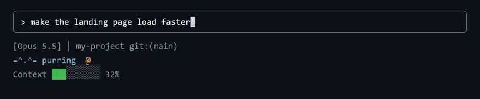
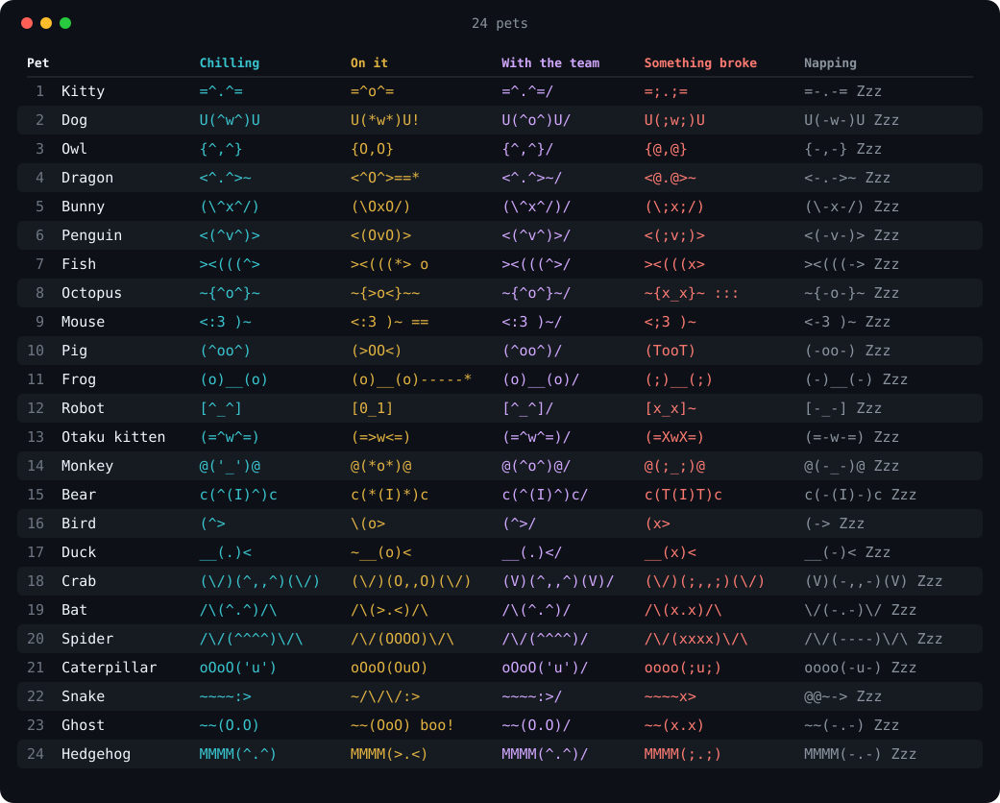
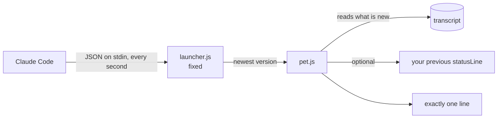

<div align="center">


# claude-pets

**24 tiny ASCII pets that keep you company in the Claude Code statusLine.**<br>
She takes **exactly one line**. Always. By design. And when your agent team gets to work, every agent shows up beside her with its real name.

  <a href="https://github.com/jfcarpiopuntocom/claude-pets/actions/workflows/test.yml"></a>
  
  
  
  
  <a href="LICENSE"></a>

[Install](#install) · [Gallery](#gallery) · [Pick a pet](#pick) · [FAQ](#faq) · [Español](https://github.com/jfcarpiopuntocom/claude-mascotas)

</div>

---

## 🐾 What is it?

An ASCII pet that lives in your [Claude Code](https://code.claude.com) statusLine and reacts to what is going on:

<p align="center"></p>

| When… | The kitty (the default) |
|---|---|
| nothing is happening | `=^.^= purring` |
| Claude is working | `=^o^= on it...` |
| your agent team is at work | `=^.^=/ 2 agents working  =^o^= strategist  =^O^= researcher` |
| the last tool call failed | `=;.;= something broke, take a look` |
| you have been away a while | `=-.-= Zzz napping...` |

She moves on her own: `setup` asks Claude Code to redraw her every second, so she **blinks, breathes and dozes off**.

<a id="install"></a>
## 🚀 Install

Inside Claude Code:

```
/plugin marketplace add jfcarpiopuntocom/claude-pets
/plugin install pets@claude-pets
/pets:setup
```

Say hi to your pet: the kitty comes first, and there are 24 to pick from with `/pets`.

<details>
<summary><b>Prefer the terminal?</b></summary>

```
claude plugin marketplace add jfcarpiopuntocom/claude-pets
claude plugin install pets@claude-pets
```

Then open Claude Code and ask it: *"run the pets setup command"*.
</details>

### 🔄 Automatic updates

One toggle, once: `/plugin` → **Marketplaces** → `claude-pets` → **Enable auto-update**. From then on every new pet reaches you on its own. Your statusLine points at a fixed launcher that always runs the newest installed version, so you never set it up twice.

### 🤝 Already have a statusLine?

`/pets:setup` keeps it (claude-hud, ccstatusline, your own…) and slips the pet in as **one** line right below the model line. It backs up your `settings.json` the first time and never overwrites that backup. If your statusLine takes longer than 4 s, the pet shows alone for that refresh instead of freezing (tune it with `chainTimeoutMs`).

### 👋 Uninstall

```
/pets:remove
/plugin uninstall pets@claude-pets
```

`/pets:remove` puts back the statusLine you had before. Your chosen pet stays saved in case you come back.

<a id="gallery"></a>
## 🎨 Gallery

24 to start with. This is just the beginning.


<!-- gallery:start -->
<p align="center"></p>

<details>
<summary><b>Show the gallery as text (to copy the names)</b></summary>

| # | Pet | Chilling | On it | Something broke | Napping | Key |
|---|---|---|---|---|---|---|
| 1 | **Kitty** | `=^.^=` <sub>purring</sub> | `=^o^=` | `=;.;=` | `=-.-= Zzz` | `kitty` |
| 2 | **Dog** | `U(^w^)U` <sub>woof! right here</sub> | `U(*w*)U!` | `U(;w;)U` | `U(-w-)U Zzz` | `dog` |
| 3 | **Owl** | `{^,^}` <sub>hoo-hoo...</sub> | `{O,O}` | `{@,@}` | `{-,-} Zzz` | `owl` |
| 4 | **Dragon** | `<^.^>~` <sub>guarding the hoard</sub> | `<^O^>==*` | `<@.@>~` | `<-.->~ Zzz` | `dragon` |
| 5 | **Bunny** | `(\^x^/)` <sub>ears up</sub> | `(\OxO/)` | `(\;x;/)` | `(\-x-/) Zzz` | `bunny` |
| 6 | **Penguin** | `<(^v^)>` <sub>tux on, all set</sub> | `<(OvO)>` | `<(;v;)>` | `<(-v-)> Zzz` | `penguin` |
| 7 | **Fish** | `><(((^>` <sub>blub, swimming...</sub> | `><(((*> o` | `><(((x>` | `><(((-> Zzz` | `fish` |
| 8 | **Octopus** | `~{^o^}~` <sub>eight arms free</sub> | `~{>o<}~~` | `~{x_x}~ :::` | `~{-o-}~ Zzz` | `octopus` |
| 9 | **Mouse** | `<:3 )~` <sub>squeak, cheese?</sub> | `<:3 )~ ==` | `<;3 )~` | `<-3 )~ Zzz` | `mouse` |
| 10 | **Pig** | `(^oo^)` <sub>oink, all good</sub> | `(>OO<)` | `(TooT)` | `(-oo-) Zzz` | `pig` |
| 11 | **Frog** | `(o)__(o)` <sub>ribbit, chillin</sub> | `(o)__(o)-----*` | `(;)__(;)` | `(-)__(-) Zzz` | `frog` |
| 12 | **Robot** | `[^_^]` <sub>beep boop, online</sub> | `[0_1]` | `[x_x]~` | `[-_-] Zzz` | `robot` |
| 13 | **Otaku kitten** | `(=^w^=)` <sub>nyaa~</sub> | `(=>w<=)` | `(=XwX=)` | `(=-w-=) Zzz` | `otaku` |
| 14 | **Monkey** | `@('_')@` <sub>ooh-ooh, banana?</sub> | `@(*o*)@` | `@(;_;)@` | `@(-_-)@ Zzz` | `monkey` |
| 15 | **Bear** | `c(^(I)^)c` <sub>bear hug</sub> | `c(*(I)*)c` | `c(T(I)T)c` | `c(-(I)-)c Zzz` | `bear` |
| 16 | **Bird** | `(^>` <sub>tweet tweet~</sub> | `\(o>` | `(x>` | `(-> Zzz` | `bird` |
| 17 | **Duck** | `__(.)<` <sub>quack, floating</sub> | `~__(o)<` | `__(x)<` | `__(-)< Zzz` | `duck` |
| 18 | **Crab** | `(\/)(^,,^)(\/)` <sub>snip snip, sideways</sub> | `(\/)(O,,O)(\/)` | `(\/)(;,,;)(\/)` | `(V)(-,,-)(V) Zzz` | `crab` |
| 19 | **Bat** | `/\(^.^)/\` <sub>night flight</sub> | `/\(>.<)/\` | `/\(x.x)/\` | `\/(-.-)\/ Zzz` | `bat` |
| 20 | **Spider** | `/\/(^^^^)\/\` <sub>chilling on the web</sub> | `/\/(OOOO)\/\` | `/\/(xxxx)\/\` | `/\/(----)\/\ Zzz` | `spider` |
| 21 | **Caterpillar** | `oOoO('u')` <sub>nom, a leaf</sub> | `oOoO(OuO)` | `oooo(;u;)` | `oooo(-u-) Zzz` | `caterpillar` |
| 22 | **Snake** | `~~~~:>` <sub>sss, sunbathing</sub> | `~/\/\/:>` | `~~~~x>` | `@@~-> Zzz` | `snake` |
| 23 | **Ghost** | `~~(O.O)` <sub>floating, ooOOoo</sub> | `~~(OoO) boo!` | `~~(x.x)` | `~~(-.-) Zzz` | `ghost` |
| 24 | **Hedgehog** | `MMMM(^.^)` <sub>sniff sniff</sub> | `MMMM(>.<)` | `MMMM(;.;)` | `MMMM(-.-) Zzz` | `hedgehog` |

</details>
<!-- gallery:end -->

<a id="pick"></a>
## 🎲 Pick a pet

```
/pets               # list all 24, numbered
/pets 22            # by number (1 to 24)
/pets octopus       # by name
/pets random        # let fate decide
```

To try them all: `/pets 1`, `/pets 2`… up to `/pets 24`. If another plugin already uses `/pets`, type `/pets:pets`.

Your agent team comes in the same species: pick octopus and your strategist is an octopus. As it should be.

## 👥 Your agent team

When Claude launches agents, each one shows up with its **real name or role** (the one you gave it, or its type), side by side, on the same line. When they finish, they leave. The pet remembers them even in very long sessions. If they do not all fit you see `+n`, and if the line still does not fit it is cut with `…`: **it never takes two lines**.

## 🔧 Settings

Optional. Create `~/.claude/plugins/claude-pets/config.json` (or inside your `CLAUDE_CONFIG_DIR`). It survives updates, and you only need the keys you want to change.

```json
{ "creature": "owl", "lang": "en", "color": true, "maxAgents": 4 }
```

| Option | What it does | Default |
|---|---|---|
| `creature` | the pet (see [Gallery](#gallery)) | `kitty` |
| `lang` | `en` or `es` | `en` |
| `color` | colors per mood | `true` |
| `maxAgents` | agents shown before `+n` | `4` |
| `maxWidth` | max width when your terminal does not report it | `100` |
| `chain` | your previous statusLine, kept running | set by `setup` |
| `chainTimeoutMs` | how long to wait for your previous statusLine | `4000` |

## 🧠 How it works



No dependencies, no network, no telemetry. It only reads what was added to your session transcript since last time (and notes in a tiny per-session file which agents are still active) to know whether Claude is working, whether the last tool call failed, and who on your team is still busy. If anything goes wrong it prints `=^.^=` and moves on: **it never breaks your statusLine**.

## 🗺️ Roadmap

- [x] One-line pets
- [x] One little pet per agent, with its real name
- [x] 24 pets: `/pets 22`, `/pets octopus`, `/pets random`
- [x] Automatic updates
- [ ] Dozens more (missing one? [ask for it](https://github.com/jfcarpiopuntocom/claude-pets/issues/new?template=new-pet.yml))
- [ ] Seasonal pets
- [ ] Moods by time of day

<a id="faq"></a>
## ❓ Questions nobody asked

**Why does this exist?** It was a side project to learn Claude Code. It got slightly out of hand.

**How much is it?** Nothing. You may evaluate it for 40 days, and after that, too.

**Can she take two lines?** No. She's a cat, not a novel.

**Windows, macOS, Linux?** Yes, tested on all three on every change. She only needs Node.

**Does it do anything useful?** It tells you when Claude is working, when something broke, and who on your team is still busy. And it keeps you company. That counts.

**¿Español?** Sí: [claude-mascotas](https://github.com/jfcarpiopuntocom/claude-mascotas).

## 🤝 Contributing

Your favorite animal is missing? See [CONTRIBUTING.md](CONTRIBUTING.md): adding a pet is 5 lines of JSON.

## 📄 License

[MIT](LICENSE). Use it, change it, share it.

---

<div align="center">

<sub>by J.F.Carpio — <a href="https://jfcarpio.com">jfcarpio.com</a> — for Avatiun Consultores</sub><br>
<sub><code>=^.^=</code> "forever" subject to cats continuing to exist.</sub>

</div>
